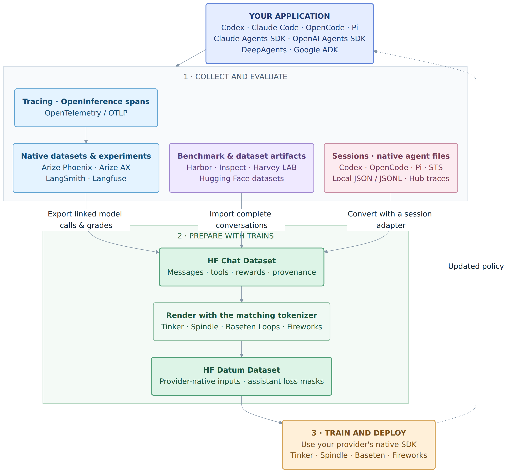

<p align="center"><br>Turn your Evals into Trains.</p>

<p align="center">
  <a href="https://github.com/wenkesj/trains/actions/workflows/ci.yml"></a>
  <a href="https://github.com/wenkesj/trains/actions/workflows/pages.yml"></a>
  <a href="https://wenkesj.github.io/trains/#/docs/guides/overview"></a>
</p>
<hr>

> This project is in it's alpha stages. We're trying something new here! Laying down the tracks for something potentially really cool and easy to use. For that reason, we're open to changing directions, the code, the protocol, you name it. The examples in this repo are suggestive, they are not meant to prove any specific hyperparameters work and each of them should be tuned on their own. Inference and training can get expensive, especially to experiment, so please be mindful.
>
> **Please train on data responsibly and respectfully.**

Trains is an **experimental** Python library for converting model traces, native agent sessions, benchmark trajectories, and datums into [Hugging Face Datasets](https://huggingface.co/docs/datasets). Inject Trains in your evals loop, and you're inches away from discovering RL.

Trains _tries it's best_ to recover messages, tools, model identity, rewards, and task groups from traces and popular eval framework formats out there.

There is no one standard that exists out there right now, this isn't try to be one.



**Documentation:** [User guide and recipes](https://wenkesj.github.io/trains/#/docs/guides/overview) · **Source:** [wenkesj/trains](https://github.com/wenkesj/trains)

## Installation

Install from GitHub source with your preferred package manager (Git and Python 3.12+ required). PyPI publishing is disabled:

```bash
pip install "trains-sdk @ git+https://github.com/wenkesj/trains.git#subdirectory=trains"
# or
uv add "trains-sdk @ git+https://github.com/wenkesj/trains.git#subdirectory=trains"
# or
poetry add "git+https://github.com/wenkesj/trains.git#subdirectory=trains"
```

See [optional integrations](https://wenkesj.github.io/trains/#/docs/guides/tracing) for the available extras. To develop Trains itself, follow [Contributing](#contributing).

## Use Trains

Start with your source:

| Source | Dataset builder |
| --- | --- |
| Phoenix, Arize AX, Langfuse, LangSmith | `chat_dataset_from_tracing_provider` |
| Codex, OpenCode, Pi, or STS sessions | `chat_dataset_from_sessions(path, adapter=...)` |
| Harbor | `chat_dataset_from_harbor_job` |
| Harvey LAB | `chat_dataset_from_harvey_run` |
| Inspect | `chat_dataset_from_inspect_log` |
| HF/TRL or Chat Datasets | `datum_dataset_from_chat_dataset` |
| Datums | `datum_dataset_from_datums` |

### Tracing

The general observability pattern across the providers is traces, Dataset API, and Experiment API.
Trace enforces [OpenInference specification](https://arize-ai.github.io/openinference/spec/) on traces.
You can add your own trace specification using the library.
You want to use native session storage like DynamoDB, Postgres, or SQLite instead of tracing? Add support!

### Examples

For runnable collection → training → evaluation workflows, choose an
[example](examples/README.md).

## Learn more

| Guide | What you will learn |
| --- | --- |
| [Datasets](https://wenkesj.github.io/trains/#/docs/guides/overview) | Create, persist, and iterate over a dataset |
| [Datasets and formats](https://wenkesj.github.io/trains/#/docs/guides/datum) | Prepare messages conversations and ATIF data |
| [Tracing providers](https://wenkesj.github.io/trains/#/docs/guides/tracing) | Export traces and attach evaluator rewards |
| [Code reference](https://wenkesj.github.io/trains/#/docs/reference/python) | Generated signatures, docstrings, types, and source |
| [Python reference](https://wenkesj.github.io/trains/#/docs/reference/python) | Dataset builders and extension protocols |
| [Examples](https://wenkesj.github.io/trains/#/docs/guides/examples) | Use native SDKs for SFT, policy updates, and checkpoints |

## Repository layout

| Directory | Purpose |
| --- | --- |
| [trains/](trains/README.md) | Python library |
| [train/](train/README.md) | Best effort, local training server compatible with provider SDK |
| [examples/](examples/README.md) | Independent native harness, dataset, training, and deployment examples |
| [docs/](docs/README.md) | Public guides and Python reference |
| [pygate/](pygate/README.md) | A _special_ Python style checker used by this workspace |

## Contributing

Bug reports, documentation improvements, format adapters, and provider integrations are welcome.
Just submit a PR with a plan or implementation with the fix.

### Set up a development environment

Install [uv](https://docs.astral.sh/uv/), then clone the repository:

```bash
git clone https://github.com/wenkesj/trains.git
cd trains
uv sync --all-packages --all-extras
```

### Run checks

Check each changed Python member separately:

```bash
uv run ruff check trains
uv run pygate check trains
uv run python -m pytest trains/tests -q
uv run ty check --project trains --python .venv
```

[GitHub Actions](.github/AUTOMATION.md) cover CI, dependency scans, and prepared Pages deployment. See [contribution rules](CONTRIBUTING.md) for commit, branch, and review requirements.
